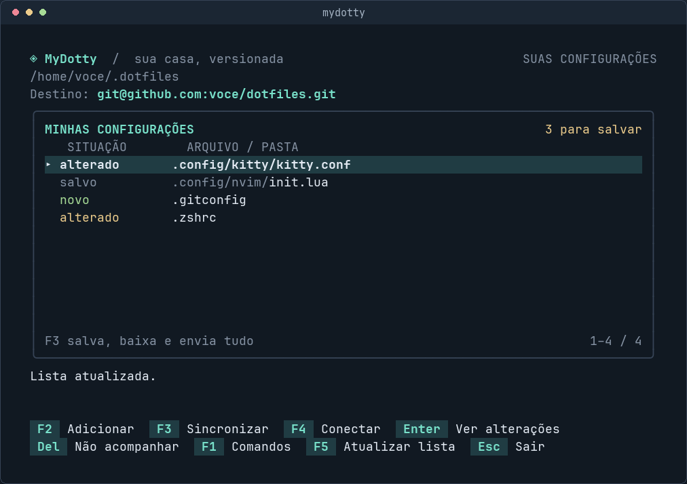
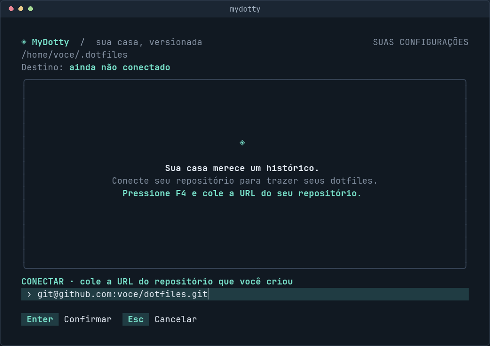
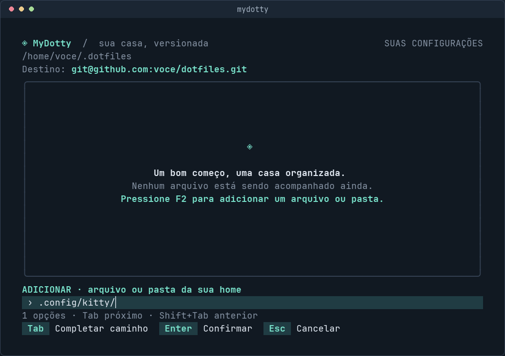
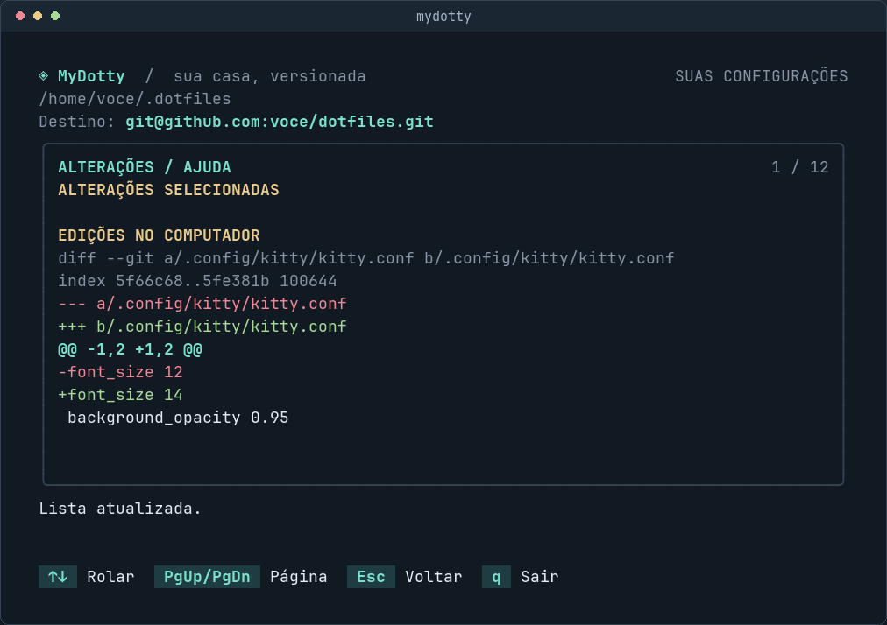
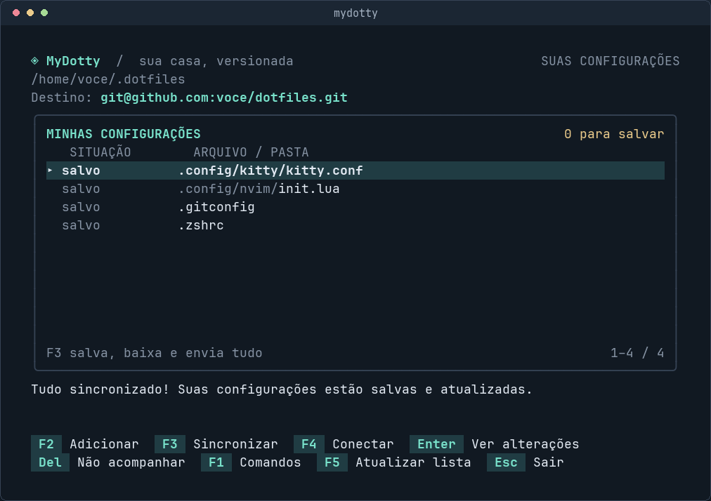

# MyDotty

**Suas configurações, salvas e sincronizadas entre computadores.**

O MyDotty cuida dos seus *dotfiles*: arquivos de configuração como `.zshrc`, `.gitconfig` e os que ficam em `.config/`. Você escolhe o que acompanhar, e o programa salva as alterações e sincroniza com um repositório seu. Não é necessário aprender comandos Git para o uso diário.

Os arquivos continuam onde seus aplicativos esperam encontrá-los. O histórico fica em `~/.dotfiles`.



*Capturas geradas a partir da interface do MyDotty, com caminhos e repositório de exemplo.*

[Instalar](#instalação) · [Primeiro uso com imagens](#primeiro-uso-passo-a-passo) · [Comandos](#comandos-e-atalhos) · [Outro computador](#usar-em-outro-computador) · [Atualizar](#atualizar-o-mydotty) · [Ajuda](#quando-algo-não-funcionar)

## Instalação

O instalador foi testado em **Linux**. Para instalar a partir deste repositório, tenha **Git** e **Go 1.24 ou superior** instalados.

```sh
git clone https://github.com/alepspizzetti/MyDotty.git
cd MyDotty
./install.sh
```

O script compila o programa para sua máquina e instala `mydotty` em `/usr/local/bin`. Se precisar de permissão, solicita `sudo` durante a instalação. Depois, você pode chamar o comando de qualquer pasta:

```sh
mydotty
```

O Go é necessário para compilar; o programa instalado precisa apenas do Git. Sem Go, o instalador só funciona se já houver um executável `mydotty` compatível ao lado do script. O clone deste repositório não inclui esse executável.

<details>
<summary>Instalar somente para meu usuário, sem sudo</summary>

Dentro da pasta do projeto, execute:

```sh
PREFIX="$HOME/.local" ./install.sh
```

A instalação será em `~/.local/bin`. Essa pasta precisa estar no `PATH` do seu shell; o instalador avisa quando ela não está.

</details>

## Primeiro uso: passo a passo

Você precisa de **dois repositórios diferentes**: o do MyDotty, que contém o programa, e um repositório seu, que receberá suas configurações. Nos exemplos abaixo, o seu se chama `dotfiles`.

### 1. Conecte seu repositório — F4

Crie um repositório no GitHub, GitLab ou outro serviço e copie a URL de acesso. Ele pode começar vazio. Para configurações pessoais, prefira um repositório privado.

Abra `mydotty`, pressione **F4**, cole a URL do **seu repositório de configurações** e confirme com **Enter**.



O MyDotty cria e configura o `~/.dotfiles` local e conecta o destino. Se o remoto já contiver configurações, tenta instalá-las nos caminhos originais.

O Git precisa ter acesso ao destino: use sua chave SSH ou o gerenciador de credenciais do serviço. O MyDotty aproveita esse acesso; ele não solicita senhas dentro da interface.

### 2. Escolha o que acompanhar — F2

Pressione **F2** e informe um arquivo ou uma pasta. Exemplos:

```text
.zshrc
.gitconfig
.config/kitty
.config/nvim
```

Use **Tab** para completar o caminho. Na captura abaixo, digitar `.config/ki` e pressionar Tab completou `.config/kitty/`. Confirme com **Enter** para adicionar a pasta.



Os caminhos relativos começam na **sua home**, mesmo que você abra o MyDotty em outra pasta. Caminhos absolutos e `~/` também funcionam.

| No campo Adicionar | O que acontece |
| --- | --- |
| **Tab** | Completa o trecho comum ou a única opção encontrada |
| **Tab** novamente | Percorre as opções disponíveis |
| **Shift+Tab** | Percorre as opções anteriores |
| **Enter** | Adiciona o caminho preenchido |
| **Esc** | Cancela a entrada |

Espaços, acentos e arquivos ocultos são aceitos. **Dentro da interface, digite caminhos com espaços sem aspas.** O autocomplete é do MyDotty e funciona independentemente do shell; ele não carrega plugins ou sugestões personalizados do Bash, Zsh ou Fish.

Adicionar uma pasta inclui seus arquivos atuais. Para incluir arquivos novos criados nela depois, adicione a pasta novamente. O MyDotty não acompanha automaticamente todos os arquivos da sua home.

### 3. Confira o que mudou — Enter

Na lista, use **↑/↓** para selecionar um arquivo e **Enter** para abrir suas diferenças. Linhas vermelhas mostram o que foi removido; linhas verdes mostram o que foi adicionado. Pressione **Esc** para voltar.



A lista principal usa nomes simples para mostrar o estado dos arquivos:

| Situação | Significado |
| --- | --- |
| **novo** | Foi adicionado ao acompanhamento e aguarda o próximo salvamento |
| **alterado** | Tem alterações para salvar |
| **removido** | Sua exclusão aguarda salvamento |
| **salvo** | A versão local corresponde ao histórico salvo |

“Salvo” descreve o histórico local. A mensagem após sincronizar informa se o envio ao destino foi concluído.

### 4. Salve e sincronize — F3

Pressione **F3**. Em uma ação, o MyDotty:

1. Salva as alterações dos arquivos que você já adicionou, com uma descrição automática.
2. Baixa as novidades do repositório.
3. Combina as alterações e envia a versão atualizada.

Ao terminar, confira a mensagem **“Tudo sincronizado!”**.



No uso diário, basta editar suas configurações normalmente e pressionar **F3** quando quiser salvar e sincronizar. Use **F2** quando quiser acompanhar outros arquivos.

## Comandos e atalhos

Prefere ficar no shell? As mesmas ações estão disponíveis sem abrir a interface:

| Terminal | Na interface | Ação |
| --- | --- | --- |
| `mydotty` | — | Abrir a interface |
| `mydotty --init URL` | **F4** | Conectar seu repositório e preparar o `.dotfiles` |
| `mydotty --add CAMINHO` | **F2** | Adicionar um arquivo ou pasta |
| `mydotty --att` ou `mydotty --sync` | **F3** | Salvar, baixar e enviar alterações |
| `mydotty --status` | **F5** | Consultar os arquivos; na interface, atualizar a lista |
| `mydotty --diff CAMINHO` | **Enter** | Ver alterações do arquivo selecionado |
| `mydotty --remove CAMINHO` | **Del** | Parar de acompanhar, mantendo os arquivos locais |
| `mydotty --apply` | **F4**, se a instalação estiver pendente | Repetir a instalação após mover caminhos existentes |
| `mydotty --help` | **F1** | Consultar comandos e instruções |

**Esc** cancela entradas e fecha diferenças; na tela principal, sai do programa. **Ctrl+C** também encerra. Na interface, **Del** abre uma confirmação antes de parar de acompanhar o arquivo. Depois, sincronize para registrar essa retirada no repositório.

Exemplo de primeiro uso pelo terminal:

```sh
# Substitua pela URL do SEU repositório de configurações.
mydotty --init git@github.com:voce/dotfiles.git
mydotty --add .config/kitty
mydotty --add .zshrc
mydotty --att
```

No shell, use aspas para caminhos com espaços:

```sh
mydotty --add "$HOME/.config/meu app"
```

A expansão de `~`, variáveis e o autocomplete nessa linha de comando continuam sendo os do seu shell. Os caminhos relativos informados ao MyDotty continuam partindo da home.

## Usar em outro computador

1. Instale o MyDotty e prepare o acesso Git ao seu serviço.
2. Abra `mydotty` e pressione **F4**, ou execute `mydotty --init URL`.
3. Informe a **mesma URL do seu repositório de configurações**.
4. O MyDotty baixa e instala os arquivos nos caminhos originais.
5. Use **F3** para manter os computadores sincronizados.

Se um caminho já existir, o MyDotty interrompe a instalação sem sobrescrevê-lo. Mova esse caminho para um backup e pressione **F4**, ou execute `mydotty --apply`, para tentar novamente. Pais simbólicos que redirecionariam a instalação também são rejeitados.

O MyDotty sincroniza os arquivos de configuração. A instalação dos aplicativos é feita separadamente.

## Atualizar o MyDotty

Na pasta onde você clonou **o projeto MyDotty**, execute:

```sh
git pull
./install.sh
```

Isso atualiza o código e substitui o executável global. Se você instalou somente para seu usuário, repita o mesmo destino:

```sh
git pull
PREFIX="$HOME/.local" ./install.sh
```

A atualização não é automática e preserva seu `.dotfiles`. **`mydotty --att` sincroniza suas configurações; não atualiza o programa.**

## Quando algo não funcionar

| O que aconteceu | O que fazer |
| --- | --- |
| O instalador pede Go | Instale Go 1.24 ou superior para compilar a partir deste repositório |
| `mydotty` não foi encontrado | Confira se a pasta de instalação está no PATH; o padrão é `/usr/local/bin` |
| Não foi possível acessar o repositório | Confira a URL e o acesso SSH ou as credenciais do Git |
| A instalação encontrou um arquivo existente | Mova o caminho indicado para um backup e tente novamente com **F4** ou `--apply` |
| Estou sem conexão | Suas alterações ficam salvas localmente; tente **F3** novamente quando a conexão voltar |
| Dois computadores alteraram as mesmas partes de um arquivo | O MyDotty desfaz a tentativa de integração e preserva a versão local salva; as versões precisam ser conciliadas antes de sincronizar novamente |
| O terminal está pequeno | Amplie para pelo menos **60 colunas × 16 linhas** |
| F2 ou F3 controla brilho ou volume no notebook | Experimente **Fn+F2** ou **Fn+F3** |

A resolução de conflitos ainda não tem um assistente dentro da interface. O MyDotty não faz envio forçado nem escolhe automaticamente qual versão descartar.

## Detalhes e desenvolvimento

O MyDotty usa um repositório Git *bare* em `~/.dotfiles` e a home como árvore de trabalho. Também funciona com repositórios existentes nesse formato. Adicionar a home inteira ou os dados internos do Git é bloqueado.

A identidade Git existente é reutilizada. Se ela não estiver configurada, o programa usa `MyDotty <mydotty@localhost>` somente nesse repositório, sem alterar configurações globais.

Para usar caminhos personalizados:

```sh
mydotty --repo /caminho/repositorio --home /caminho/configuracoes
```

Para verificar o código:

```sh
go test -race ./...
go vet ./...
```

Os testes usam repositórios temporários, sem acessar o GitHub nem modificar seus dotfiles. Cobrem instalação, repositório vazio, sincronização entre computadores, conflitos, alterações offline, CLI, autocomplete e limites de tamanho da interface.

A interface usa Bubble Tea e Lip Gloss. Operações Git executam fora do processamento de eventos da interface, com limite de 90 segundos por comando.

## Licença

[MIT](LICENSE).
